# Architecture

How OmniGateway is put together, for contributors and design auditors. [How it is
built](#how-it-is-built) has the crate map and layering rules; the rest of this document
details what sits behind them. Conventions that govern changes — boundaries, testing, traps —
are in [CLAUDE.md](CLAUDE.md). Approved designs live in `docs/superpowers/specs/`.

Narrower references: [quota runtime](docs/rust-quota-runtime.md), [CLI service
boundary](docs/rust-cli-service.md), [cluster bucket sweep](docs/rust-cluster-bucket-sweep.md).

## Contents

- [How it is built](#how-it-is-built)
- [What a request actually does](#what-a-request-actually-does)
- [Observability](#observability)
- [Rate limiting](#rate-limiting)
- [Routing](#routing)
- [Dispatch](#dispatch)
- [Providers](#providers)
- [Storage](#storage)
  - [Body capture forensics](#body-capture-forensics)
  - [Replacing the database while it is open](#replacing-the-database-while-it-is-open)
- [Background loops](#background-loops)
  - [Stopping and restarting](#stopping-and-restarting)
- [Push transport](#push-transport)
- [The console and the CLI](#the-console-and-the-cli)
- [Plugins](#plugins)
- [Clustering](#clustering)
- [Account-derived provider catalogs](#account-derived-provider-catalogs)

## How it is built

One Cargo workspace (`crates/`, 14 crates) building one binary, `omnigateway`, plus a React
console built with Bun into `apps/dashboard/dist` and served by that binary. The binary is also
the CLI: invoked as `omni` (a symlink in every release archive) or as `omnigateway omni …`,
`crates/omni-gateway/src/main.rs` hands argv to `omni_cli::run` before any runtime starts.

The layering is enforced by what each crate may depend on: a provider-neutral core at the
bottom, provider knowledge in one crate, pure ranking and limit arithmetic above that, and every
side effect pushed up into the gateway process.

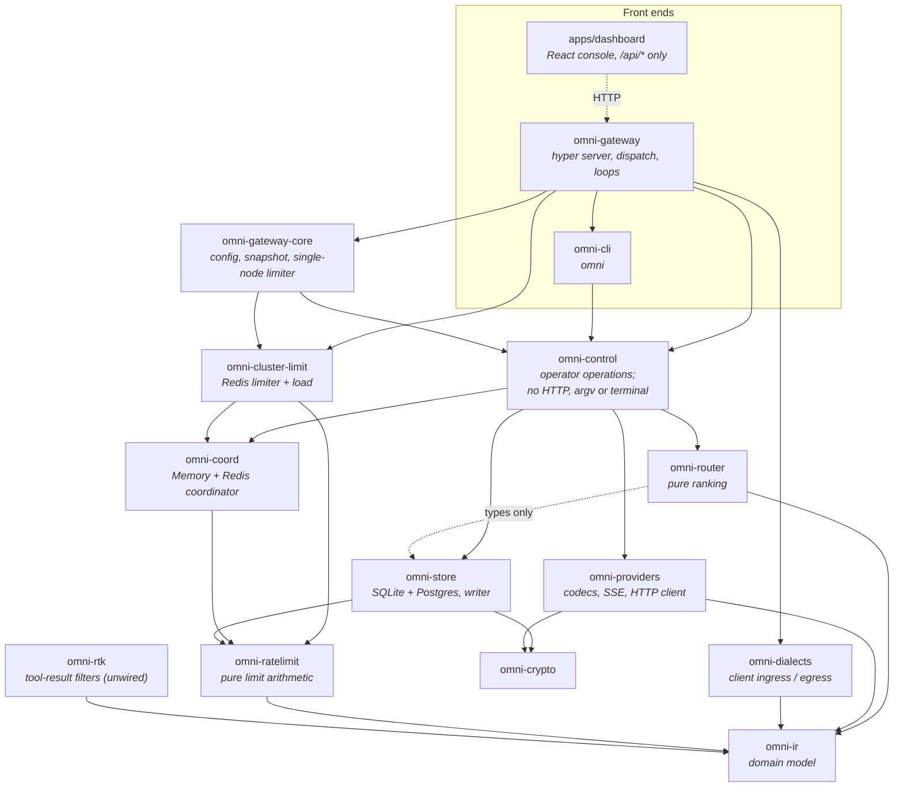

Arrows read *depends on* (a simplification of the Cargo manifests; transitive edges omitted).
`omni-ir` depends on no other crate in the workspace. `omni-router` and `omni-ratelimit` are
pure functions — no I/O, no clock, `now` and the random draw are parameters — so a ranking or a
limit decision is reproducible from its inputs. `omni-router` reads `omni-store` row types but
never opens a connection.

`omni-ratelimit` decides whether a request is over a ceiling and holds no counters; the rings,
buckets and gauges live in `omni-gateway-core/src/ratelimit.rs` (one process) and
`omni-cluster-limit` (a fleet). That split is what lets sliding-window arithmetic be tested
without a gateway, a store, or a clock (`crates/omni-ratelimit/tests/`).

`omni-control` is every operator action, shared by `/api/*` handlers and the CLI. The CLI does
not call the running server: it opens the SQLite file itself, which is why it works with the
gateway down. Postgres fleets are administered over HTTP.

The console has no build-time edge to any crate. Provider names, colours, order and models reach
it over `GET /api/catalog`, built from `crates/omni-control/data/provider-catalog.json` — the
only source of the built-in catalog. Constants the console copies from Rust are held to their
owners by `apps/dashboard/test/api/rustMirrors.test.ts`, which reads Rust source.

`omni-rtk` is built and tested but not called: dispatch sends the request as received (see
[Dispatch](#dispatch)).

## What a request actually does

`POST /v1/messages`, `POST /v1/chat/completions` and `POST /v1/responses` go through one
handler, `proxy` in `crates/omni-gateway/src/server.rs`; the dialect is a parameter.

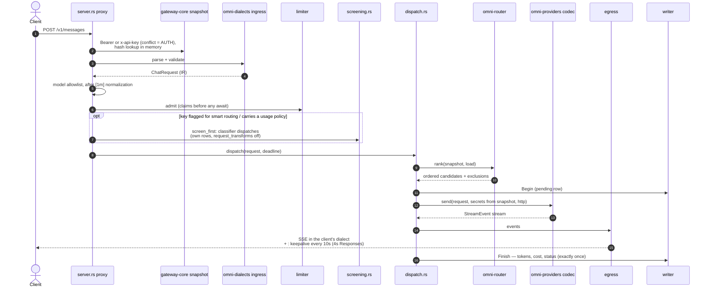

The request path performs no store read. Keys, models, credentials (with secrets already
decrypted), health, quota and settings are one `Arc<GatewaySnapshot>` behind an `ArcSwap`
(`omni-gateway-core/src/snapshot.rs`); a request loads it once. A key not yet in the snapshot is
looked up by one guarded store read (`miss.rs`: negative cache, read budget).

The log row opens on the first routed attempt (`LogEvent::Begin`) and closes exactly once: a
`Finisher` (`finish.rs`) sends `Finish`, and if dropped unsent — the client hung up — sends the
499 row instead. Persistence is the batched writer's (see [Storage](#storage)).

**Usage policies** (`screening.rs`). A key with a `guardrail_policy` has each inference request
judged after admission, inside the event sequence the encoder consumes (`screen_first`): a
streaming route sends its head at once, keepalives cover the classifier, a refusal is an
in-stream error. The classifier is an ordinary dispatch with its own request id and row, with
`request_transforms: false`. Only a bare `ALLOW` from a finished reply admits; deny, timeout,
unreadable reply and unset `guardrailModel` all refuse. Verdicts are cached per process for an
hour (`VERDICT_TTL_MS`).

**Confidential routing** (same file). With the key's `smart_routing` flag and the global
`smartRouterEnabled`, every text the request carries is segmented and classified against
`smartRouterClassifierModel`; a confidential verdict re-dispatches to `smartRouterLocalModel`
with `local_only`, which admits only virtual models whose every target is `custom`. Fails
closed, never falls back external. Smart routing runs before the guardrail.

`GET /v1/models` is answered from the snapshot, smallest target window per model.
`POST /v1/messages/count_tokens` is a local estimate (`omni_ir::tokens`), charged to the
`requests` dimension only, writing no usage row.

## Observability

`crates/omni-gateway/src/telemetry.rs` (Prometheus registry and renderer) and `otlp.rs` (span
encoder, bounded queue, exporter). Three constraints shape it:

1. `/metrics` reads no store and calls no coordinator; every exported value is process-local. It
   exists only when `OMNI_METRICS_TOKEN` is set and requires exactly `Bearer <token>`.
2. Trace context is inbound only. `TraceHttp` wraps the provider `HttpClient` to time requests and
   adds no header, so no `traceparent` reaches a provider.
3. Without `OMNI_OTLP_ENDPOINT` nothing is traced; the exporter drops rather than delaying or
   failing a request.

Vocabulary and rationale: [the observability design](docs/superpowers/specs/2026-09-04-observability-design.md).

## Rate limiting

A limit is a `(dimension, window)` pair. The pairs that exist are the ones that mean something:

| Dimension | 1m | 5h | 1w | Counted from |
| --- | --- | --- | --- | --- |
| `requests` | ✓ | ✓ | ✓ | bounded history at `1m`; seeded buckets + debits above it |
| `tokens` | ✓ | ✓ | ✓ | seeded buckets, debited on completion |
| `spend` (USD) | — | ✓ | ✓ | seeded buckets, debited on completion |
| `concurrency` | *no window — a gauge* | | | in-flight count |

No `spend` at `1m` — a per-minute dollar ceiling is a rate limit in costume. Every window
**slides**: a fixed window lets a key limited to sixty a minute send sixty at `T+59s` and sixty
more at `T+61s`.

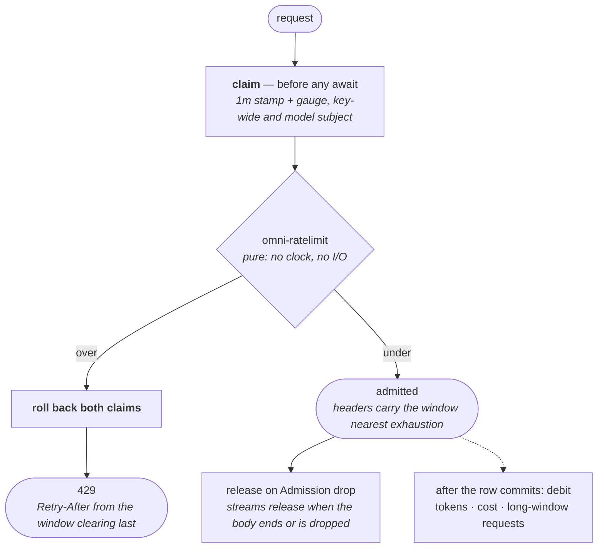

**The claim is taken before any await** and given back on refusal; read-then-record would let a
burst judge one pre-burst snapshot. Pins: `crates/omni-gateway-core/tests/ratelimit.rs`
(`a_burst_against_a_1m_ceiling_admits_exactly_the_ceiling_*`).

**Counts may run high, never low.** Long windows are time buckets (`buckets.rs`) seeded from the
store and debited by every completed request **after its row commits**: the writer delivers each
batch's completions and runs seed reads on its own connection between batches, on one ordered
channel (`ratelimit_seed.rs`), so a row is counted by the seed or by its debit, never both and
never neither. Seeding does not block: an unseeded window admits against what can be checked
(deliberate, documented in `ratelimit.rs`). A refusal's exact reset is read
from the row stamps the seed loaded, so no store read precedes a 429.

**Concurrency release is structural.** The single-node gauge is freed when the `Admission` is
dropped, so the gauge cannot leak; the cluster gauge does need TTL and
renewal (see [Clustering](#clustering)).

**Per-model overrides stack, judged in one admission.** `limits.models` gives one requested model
(after `[1m]` normalization) its own matrix; `LimitConfig::model_override` is the only lookup.
The override counts under its own subject (`omni-cluster-limit/src/subject.rs`), one admission
claims both subjects, `combine`s the decisions, and rolls back both on refusal. Bounds
(`MAX_MODEL_OVERRIDES`, `MAX_MODEL_NAME_LENGTH`) in `omni-ratelimit/src/limits.rs`. Design:
[per-model limits](docs/superpowers/specs/2026-10-16-per-model-key-limits-design.md).

Limits are one JSON object on `api_keys.limits`; dimension and window names are a storage
contract that fails **closed** — an unknown name is a parse failure, refused at authentication
as `INTERNAL`, while the key list still returns the row so an operator can find it.

Clients see each vendor's own headers — `anthropic-ratelimit-*`, `x-ratelimit-*`, `Retry-After`
on every 429 (`omni-dialects/src/egress/`). `spend` and `concurrency` appear on neither.

## Routing

`rank` (`crates/omni-router/src/rank.rs`) is a pure function over the routing snapshot plus live
in-flight counts and recent latency. It returns candidates in order and every excluded account
with its reason — what `omni models dry-run` prints.

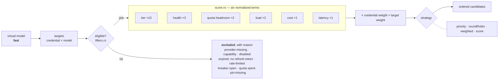

Weights are settings defaults. A request carrying a provider-defined tool or `ProviderNative`
history block is owned by that provider; other providers' targets are excluded at filter stage
as `capability:providerNative` (`required_providers`), so it fails at routing with the
requirement named rather than losing the tool. "Rate-limited" here is
`credential_health.rate_limited_until`, set from the provider's own `Retry-After` — not a key limit.

A target may name one account in `credential_id`; then only that account serves it. The pin is a
hard filter: a disabled, breakered, rate-limited or spent account fails the request rather than
spilling to a sibling. A pin resolving to no account is reported once per target as
`pin:missing`. Whether an account serves a target — provider, custom endpoint, pin — is one
question, `serves_target` in `filters.rs`, which `model_limits`, doctor and agent setup also ask.
Nothing validates pin existence at write time; doctor reports dangling pins.

`resolve_model` (`resolve.rs`) resolves a configured virtual model first, then `provider/model`
syntax, then a bare well-known model name by longest prefix from `Providers::builtin`
(`providers.rs`, catalog rows from the JSON). `custom` never prefix-routes: a bare name cannot
carry an endpoint id.

## Dispatch

`crates/omni-gateway/src/dispatch.rs` is where the side effects the router refuses live: deadline,
retries, failover, token refresh, health writes, pricing (`price.rs`), load accounting (`load.rs`).

**A success writes health only when it would change something routing decides on.**
`success_would_change` (`omni-router/src/breaker.rs`) reads the snapshot row before the attempt
and answers true when any field `record_success` resets differs from blank. No row reads as
blank, so a healthy account ordinarily has no `credential_health` row. Every failure writes.
Health is applied to the in-memory snapshot and written through the writer; `overlay.rs` keeps
this process's writes visible until the store surely has them, so a rebuild cannot put an older
row back. The Postgres `config_version` trigger (`migrations/postgres/002_health_measurements.sql`)
fires on decision columns only. Design:
`docs/superpowers/specs/2026-09-07-credential-health-write-path-design.md`.

**An open breaker past its cooldown is probed by one request.** The router marks such a pair (and
a `halfOpen` row) `probe`; dispatch claims `probe:<healthKey>` through `Probes::claim` (local
map, or the shared coordinator in a fleet, 180 s expiry, never renewed). Held elsewhere: the
candidate is skipped as `breaker:probing` and consumes no attempt. The probe writes `halfOpen`,
and a success closes the breaker **at the commit point**, not at the end of the stream.

**Commit point.** The first `BlockDelta` commits the attempt — or the pending buffer reaching
`PENDING_MAX_EVENTS` / `PENDING_MAX_BYTES`, so a provider emitting many non-content events cannot
hold the client indefinitely.

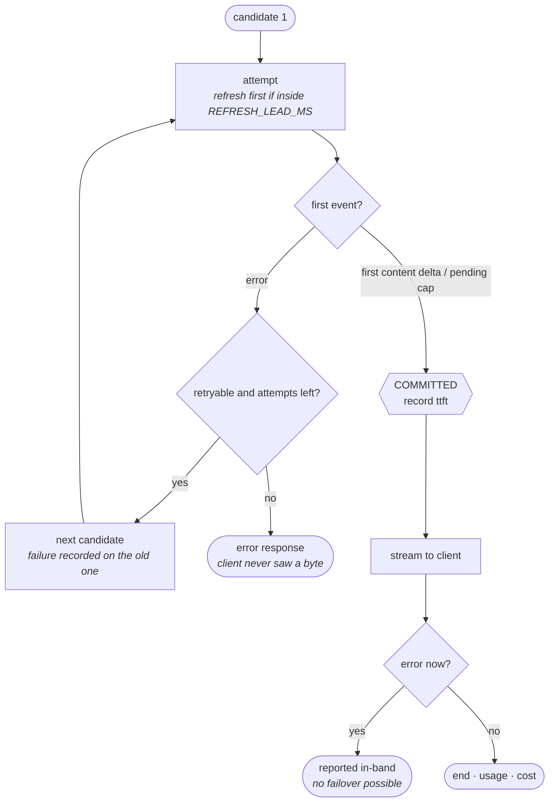

An Anthropic 401 refreshes and retries once. Cancellation is structural: dropping the stream
drops the upstream body (closing the socket), the load slot and any probe claim. Pins:
`crates/omni-gateway/tests/dispatch.rs`.

Only four providers dispatch in 1.x — `anthropic`, `openai`, `antigravity`, `custom`
(`send_provider`). Others stay in the catalog and routing registry; a target naming one fails
its attempt with `INTERNAL "no adapter for provider …"`.

**RTK and ponytail are not applied.** The settings `rtkEnabled` and `ponytailMode` are stored and
editable, and `request_logs` keeps its RTK columns, but dispatch and `count_tokens` send the
request as received. `crates/omni-rtk` is the ported filter set, unwired.

## Providers

`crates/omni-providers`: one directory per provider codec — `anthropic/`, `openai/`,
`antigravity/`, `custom/` — each roughly `codec.rs`, `wire.rs` (IR → body), `decode.rs`
(stream → `StreamEvent`), `profile.rs` (client fingerprint: header order, casing, user agent),
`oauth.rs`. Shared at the crate root: `codec.rs` (the contract), `adapter.rs` (its host),
`http/` (client), `sse.rs`, `http_error.rs`, `response_format.rs`, `tool_result_files.rs`,
`quota.rs` (usage probes).

A `ProviderCodec` describes one HTTP request and reads one stream back; nothing in it is async.
`adapter::send` performs it — build, validate, send, classify a failed status, decode — once for
every provider. `decode_state` is an associated type, so "host handed back the wrong state"
cannot be written. A codec that throws before commit fails over; after commit its error is
forwarded in-stream (`codec_failure` relabels an unclassified throw).

Three wire dialects, not two: Anthropic- and OpenAI-shaped bodies, and Antigravity's Cloud Code
Assist envelope (`v1internal:streamGenerateContent`, a Gemini request carrying the account's
Cloud Code project id). The project id is minted during OAuth and lives on
`credential.providerData`; the codec refuses a request that would send it blank. Inference uses
`daily-cloudcode-pa.googleapis.com` — the plain host answers `429 RESOURCE_EXHAUSTED` for an
account with quota left, which reads as an account problem rather than a URL one. The bootstrap
shape follows the App 2.34 capture (`tests/fixtures/antigravity-2.34.0.json`).

The OpenAI OAuth leg is the Codex surface and wears Codex 0.170.0's captured fingerprint
(`tests/fixtures/codex-0.170.0.json`, `openai_fingerprint_literals.rs`); it moves only with a new
capture (`scripts/codex-capture/README.md`). `custom` is the operator-supplied OpenAI-compatible
provider: the credential names the origin and protocol (chat or responses), which travels in
decode state because the response cannot reveal it.

Anthropic auto-mode safeguards are opaque metadata: ingress keeps `safeguards` in the vendor bag
and `anthropic-*` headers; a non-empty list disables that codec's tool cloak and system rewrite;
the decoder carries `safeguard_results` to the terminal event's vendor bag, which Anthropic
egress restores. Pins: `crates/omni-providers/tests/anthropic_decode.rs`.

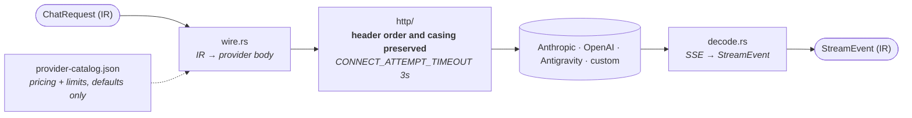

All outbound HTTP goes through one keep-alive HTTP/1.1 client (`http/`) that writes headers in
the given order and casing — providers recognise first-party clients by them — and logs only
host, path, status, duration. `CONNECT_ATTEMPT_TIMEOUT` is 3 s per address, above Linux's one
second initial SYN retransmit: a shorter budget turns a dropped SYN on a lossy path into a
connect failure that reads as a provider outage. Pin: `crates/omni-providers/tests/http_client.rs`.

The catalog supplies defaults — pricing and context limits — when a target is created. The
router prices from the saved target, so editing the catalog affects new targets only. Catalog
rows are pinned per provider by `crates/omni-router/tests/*_catalog.rs`.

## Storage

Two backends behind one `Store` (`crates/omni-store/src/backend.rs`): SQLite (default; one file,
WAL) and Postgres (`pg/`, cluster mode). Migrations are SQL files under
`crates/omni-store/migrations/{sqlite,postgres}/`, included at compile time, recorded in a
`migrations(id, applied_at)` ledger; a shipped file is frozen, because installed databases record
its id. A database from a newer build keeps its unknown migrations. Behaviour proven on one
backend is proven on the other in `crates/omni-store/tests/contract.rs`, which runs each case
against SQLite then Postgres.

**Nothing in the store runs on the request path.** The gateway serves from its snapshot (rebuilt
when SQLite's `data_version` or Postgres's config version moves, polled every 500 ms) and hands
every request-path write to **the writer** (`writer/`): a bounded channel the request path feeds
with `try_send`, one task writing one transaction per batch (4096 events or 200 ms). A full
channel drops and counts; on Postgres under pressure only optional `Begin`/`Route` events are
shed, and every admitted request reserves capacity for its `Finish`. Completion is a claim
(`state = 'pending'` → done), applied once per id, with `usage_daily` and `usage_rollup` folded in
the same transaction with SQLite's own arithmetic (`writer/num.rs`). Breaker failures and
transitions go through `HealthWriter`, a separate immediate path.

`PRAGMA synchronous = NORMAL` (`migrate.rs` `apply_pragmas`): it does not survive an OS crash —
transactions since the last WAL sync may roll back — but the file cannot be corrupted. Most of
what is exposed is replayable; a rotated OAuth refresh token is not, and that loss is accepted.

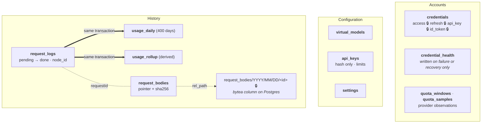

Encryption is a boundary: the four 🔒 fields are AES-256-GCM under a key derived from
`OMNI_ENCRYPTION_KEY` (`omni-crypto/src/field.rs`, `enc:v1:` format). The snapshot opens them once
per `token_version`. Gateway API keys are stored as hashes only. OAuth expiry is a nullable JS
number (`Option<f64>`) in SQLite; Postgres keeps BIGINT and refuses a non-finite value without
touching the previous token version.

**Reading `request_logs` back is one keyset-paged query** (`omni-store/src/logs.rs`,
`pg/logs.rs`), ordered `(at DESC, id DESC)`, cursor exclusive (`omni-control/src/logs.rs`, base64url),
fetch `limit + 1`. Filters and scope apply before the limit. Filters split by where the value came
from: ids, provider, state — and the scoped `apiKeyId` above all — compare with `=`; the four a
person types (`model`, `requestedModel`, `resolvedModel`, `errorCode`) are case-insensitive escaped
substrings (`LIKE` on SQLite, `ILIKE` on Postgres, `ESCAPE '\'`). Migration 017 moved those columns
into the keyset index so the scan tests index entries.

### Body capture forensics

Capture needs `OMNI_BODY_LOGGING_ALLOWED` at boot and `settings.bodyLoggingEnabled` at runtime, and
a key with `body_logging_opt_out` is never captured (checked in `server.rs` before any capture work;
`body_capture.rs`). Headers are never captured: the capture API is never handed a header list.

Masking (`omni-store/src/bodies.rs`) is best-effort and applied before write: bearer tokens,
prefixed keys, well-known vendor prefixes, long opaque tokens. It is deliberately not extensible
by providers. Payloads are bounded structurally (string length, array tail, depth, key count) so
an artifact stays valid JSON; an artifact still over 512 KB has its bodies replaced by a marker.

The envelope is `OGBA`, version, codec, claimed length, then AES-256-GCM (`pg/bodies.rs` `seal`;
SQLite writes the same bytes to a file, `bodies/sqlite.rs`). The row holds a `sha256` over the
stored envelope, so truncation is detectable without the key. Writers emit raw; readers accept
raw, gzip and legacy `enc:v1:` hex, bounded by `MAX_ENVELOPE_BYTES` before reading. Reading back
is `omni-control/src/bodies.rs`, behind `GET /api/requests/:id/body` (admin only) and
`omni bodies`. A missing, swept or undecryptable artifact is a state to report, not an error.

### Replacing the database while it is open

SQLite only; Postgres refuses snapshot, vacuum, restore and the latch (`pg_dump` is the backup).

A snapshot is `VACUUM INTO` a file in `snapshots/` beside the database (`omni-control/src/database.rs`):
consistent against a live gateway, no `-wal`/`-shm`, and `request_bodies/` excluded so a download is
never a prompt corpus. Retention — `keepLatest` and `maxAgeDays`, newest always kept — prunes on
write and on the hourly sweep; the forced snapshot taken on the way into a restore is exempt.

Restoring replaces the file every owner reads, inside the process reading it.

**Owners are registered.** Every persistent SQLite connection the gateway holds — writer and
checkpointer, routing refresher and miss resolver, auth/control, OAuth — is registered in
`omni_store::lifecycle`. A swap takes the transient-access write barrier and every owner's lock
(`lifecycle::exclusive`), so no connection to the old file survives it. Export pages and
maintenance hold transient-access leases.

**The quiesce latch gates `/v1/*` only** (`quiesce.rs`). Client requests are refused with 503 in
their dialect; `/api/*` and `/health` stay live, because the console is how the operator watches
the restore and the load balancer must keep its health check. Admission belongs to the response
lifetime, streams included; the latch drains up to 10 s and stays shut for the swap.

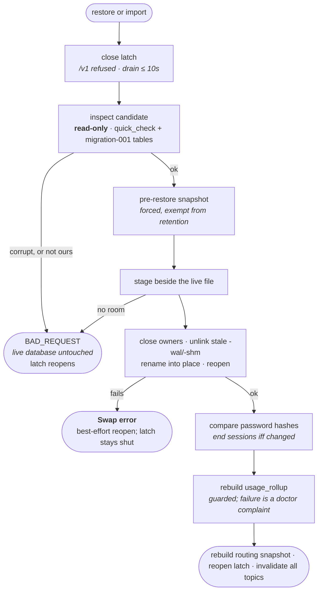

Everything before the swap fails with the live database untouched and the latch reopened. A
failure during the swap leaves the latch shut: the file it would serve from is in an unknown state.
The latch is reopened only by the call that shut it, and a successful restore — the documented way
out of a failed one — reopens it unconditionally.

**Nothing sits between the swap and the password comparison**: by then the swap has succeeded, and
a step that threw in front of the comparison would skip ending sessions while the restored password
is live. The rollup rebuild therefore runs last and guarded. Pins: `database.rs` tests
`swap_exact_sequence_keeps_forced_undo_without_retention`,
`failures_preserve_frozen_half_swap_states_and_sequences`.

`omni db restore` refuses while a gateway runs against the installation, no override: a second
process cannot quiesce the gateway's owners.

## Background loops

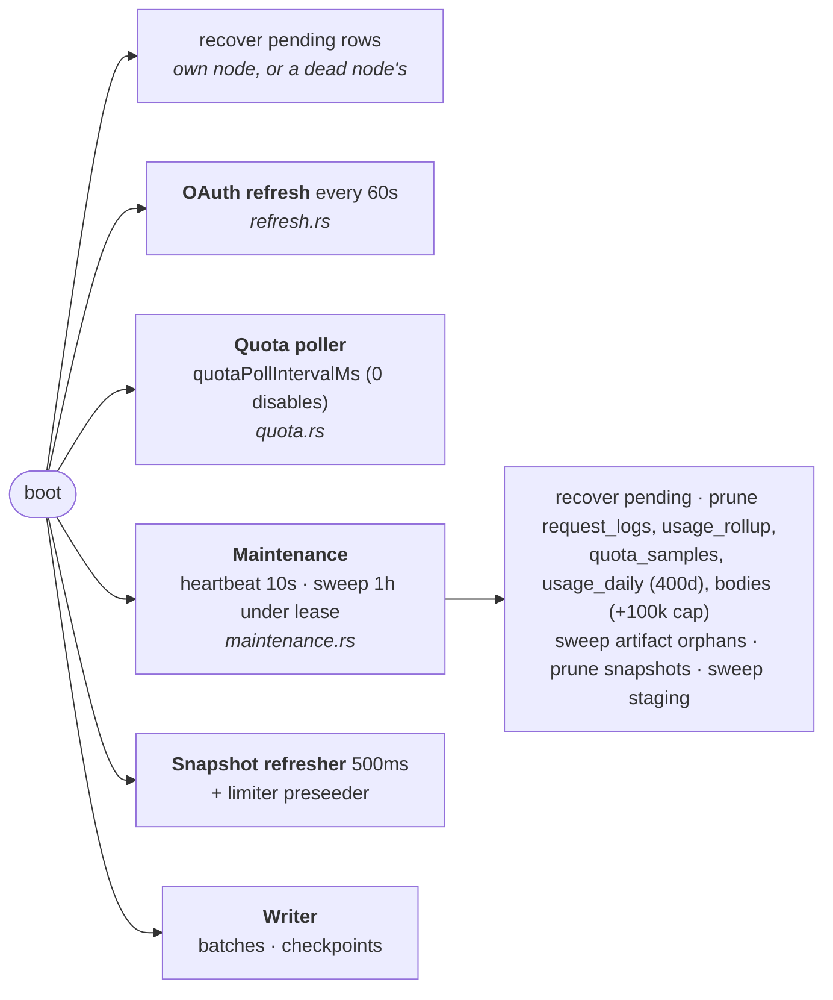

OAuth refresh renews inside its lead window and disables an expired credential with no refresh
token (`expiredNoRefresh`). Refresh is coalesced locally and, in a fleet, under a shared lock with a
re-read and a versioned CAS write (`updateSecrets` semantics), so a rotated token is never lost to a
race. The quota poller and the operator's refresh (`POST /api/credentials/quota/refresh`,
`omni quota refresh`) go through one `Quota` per process (`omni-control/src/quota_runtime.rs`); a
failed probe keeps the old snapshot and never disables a credential; a 429 cools only probing.
Details: [Rust quota runtime](docs/rust-quota-runtime.md).

### Stopping and restarting

`SIGTERM`/`SIGINT` and `POST /api/lifecycle/shutdown` reach the same teardown (`lib.rs`): stop
accepting, stop the stream hub, stop the loops, let connections drain up to `STOP_DEADLINE` (5 s),
cancel stragglers (their finishers file 499 rows), drain socket connections, join body workers,
close health writer, drain quota and refresh, then close the writer, the cluster limiter and the
coordinator, in that order. A second signal exits 1. A drain timeout exits **0**: a nonzero code
would read to `Restart=on-failure` as a crash.

Socket connections close with `1001` and a restart reason, which the console's reconnect path
expects; `4401` would tell it to stop trying.

Restart is not shutdown, and what it takes depends on the supervisor (`lifecycle.rs` `describe`):

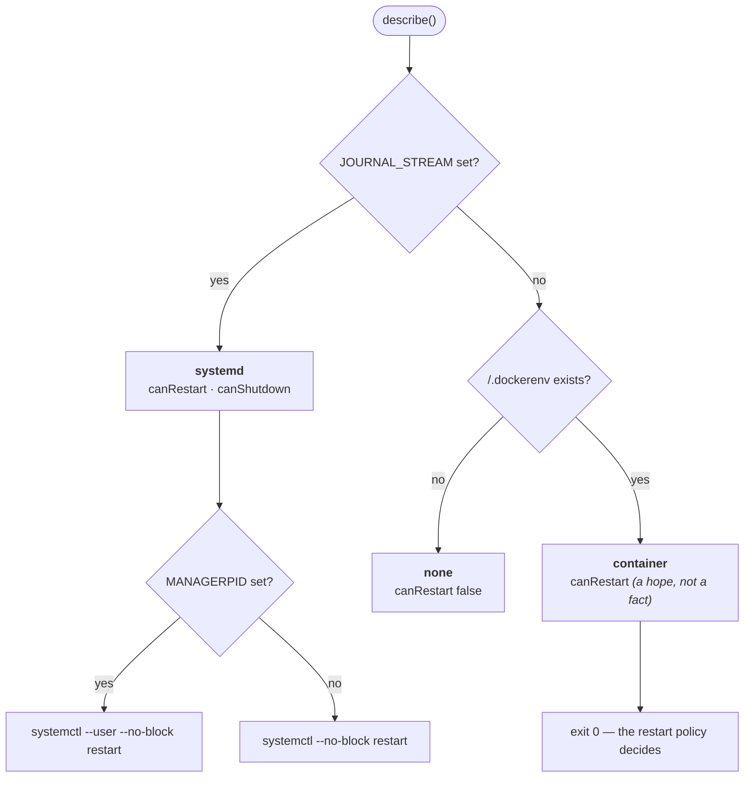

Under systemd the gateway asks the manager rather than signalling itself: the installed unit
sets `Restart=on-failure` and a handled `SIGTERM` exits 0, so a self-signalled gateway would stay
stopped. `--no-block` is load-bearing: restarting the unit tears down its cgroup, including the
`systemctl` client. A cluster replica refuses restart; roll the deployment instead.

The console watches a restart by polling `/health` until the gateway stops answering, then until
it answers again — its one exception to `/api/*` only.

## Push transport

One multiplexed WebSocket, `/api/stream` (`stream_transport.rs` over the bounded RFC 6455 codec
in `stream_codec.rs`; pure contracts in `stream.rs`). Polling stays beside it permanently: a proxy
that eats `Upgrade` is an ordinary deployment.

| Class | Carries | Guarantee |
| --- | --- | --- |
| `res:<name>` | at most `{ keys }` | none. A dropped frame self-heals at the next change; a reconnecting client invalidates everything |
| `stream:<name>` | payload | monotonic `seq` over a bounded ring; past the ring the server answers `gap` |

`res:*` exists so push and poll cannot disagree: both end in the same REST fetch. The console maps
a topic to query keys by **prefix** (`apps/dashboard/src/session/invalidation.ts`). A topic names a
resource and covers every branch reading it — `res:usage` and `res:logs` cover the console's
`["usage",…]` and the client's `["client","usage",…]`. A client principal may hold only those two
(`stream.rs` `authorised`); `plugin:*` topics are always refused.

Emitters must cover **every** change to what a topic names, because push replaces polling. The
writer's `LogObserver::committed` emits one `res:logs` per row event and, per finish, `res:usage`
too; admin mutations emit their resource (`admin_routes.rs`); the quota poller emits on pass
completion; a database swap invalidates everything, on success only.

Coalescing is mandatory, leading **and** trailing: floor 1 s for `res:usage`/`res:logs`, 5 s for
`res:quota`/`res:credentials`. Backpressure is real: per-connection queues are bounded and drop the
oldest frame, counted. Pin: `slow_queue_drops_oldest_counts_and_resumes_without_close`.

The socket must not outlive its session: the heartbeat re-verifies every 20 s and closes **4401**,
which alone means "authenticate again, do not reconnect". A verification that *errors* closes
nothing. Pin: `expired_session_upgrade_and_next_shared_heartbeat`.

The latch does not gate `/api/stream`; sockets stay open across a swap.

## The console and the CLI

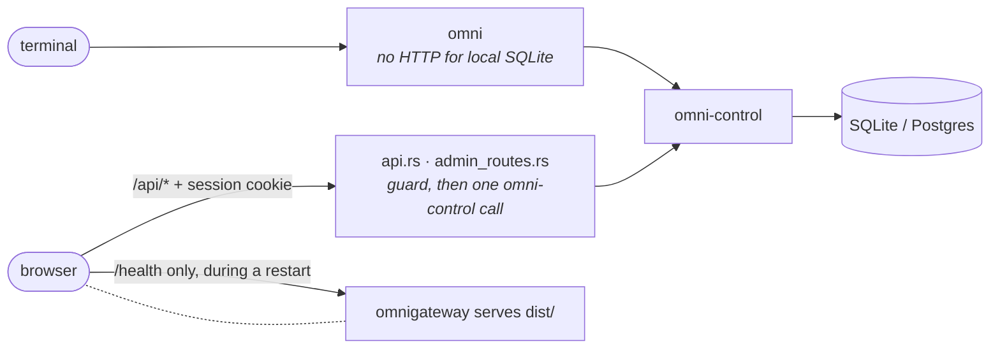

The console is a React SPA served as static files from the gateway's own origin
(`static_files.rs`: `OMNI_STATIC_DIR`, else `public/` beside the executable, else the checkout's
`apps/dashboard/dist`; paths normalised and `canonicalize`-contained). It may import nothing from
the gateway: types are mirrored in `src/api/types.ts`, single-copy helpers in `src/lib/domain.ts`.
Three principals share one cookie — `admin`, `viewer` (read-only, optional password) and `client`
(one API key's own surface at `/client`). `apps/dashboard/tooling/build.ts` bundles React normally;
there is no import map and no shared runtime.

`omni` resolves an installation root (`--root` > `OMNI_ROOT` > cwd > `~/.config/omnigateway`),
merges that root's `.env` explicitly — the gateway itself reads no `.env` — and runs
`omni-control` operations against the SQLite file. Process supervision (`omni start`, `service`)
and doctor are described in [Rust CLI service boundary](docs/rust-cli-service.md).

## Plugins

Not supported in 1.x. `<root>/plugins/` entries are warned about once at boot and never loaded;
`/api/plugins*` answers 501, `/plugin-assets/<id>/*` 404; `omni plugin *` exits 1; doctor reports
plugin directories without running them. Plugin tables in a restored database are left in
place.

## Clustering

`OMNI_CLUSTER_MODE=true` runs replicas over one Postgres primary (`OMNI_DATABASE_URL`) and one
Redis/Valkey (`OMNI_REDIS_URL`). There is no SQLite shadow. Every replica must use the same fixed
`OMNI_DAY_OFFSET_MINUTES` so one instant has one `usage_daily.day`.

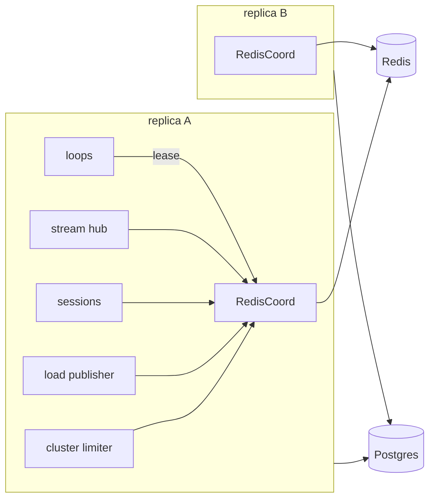

**`omni-coord`** is the interface: windows, gauges, buckets, mutex, lease, kv, pubsub, incr.
`MemoryCoord` is the single-process implementation; `RedisCoord` runs each primitive as one Lua
script (`redis/scripts.rs`, digests pinned by `scripts_are_byte_stable`), loaded once and called by
`EVALSHA` over one ordered submission queue (`redis/link.rs`), so a release cannot be overtaken by
the next acquire. Every implementation holds one property: a claim is visible to every concurrent
claimant **when issued** — memory futures complete on their first poll
(`every_memory_call_completes_on_its_first_poll`).

**Failure.** Redis unreachable: each primitive falls back to an embedded `MemoryCoord`, so limits
degrade to per-replica and no request is refused over it; a lease that cannot be confirmed is not
held; `kv` refuses (`OVERLOADED`), because a session verified against a fallback map is one a
password change elsewhere cannot end. Logged at a bounded rate. Postgres unreachable: the request
fails. Pins: `crates/omni-coord/tests/faults.rs`, `crates/omni-cluster-limit/tests/faults.rs`.

| Concern | Cluster mechanism | Exact across replicas? |
| --- | --- | --- |
| `1m` window, concurrency | one `ADMIT` script per limited request (`omni-cluster-limit`) | yes |
| `5h`/`1w` | Redis bucket hashes, seeded in the background under `omni:lock:seed:<bucket>`; debits batched with the row's commit id so a seeded row is never counted twice | yes, at the grain |
| routing load | local registry + fleet picture published/read every 100 ms (`load.rs`) | ~one interval stale |
| OAuth refresh | local coalescing + shared lock + re-read + versioned CAS | yes |
| sessions, pending OAuth, probe claims | `kv` / gauges with TTL | yes |
| maintenance sweep | under `lease("maintenance")` | one holder |
| pending-row recovery | own node's rows, or a node whose heartbeat lapsed | yes |
| push | every frame published and re-delivered, own included; `seq` from `incr` | one path |

Cluster gauge slots **expire while their holder is live**, so a long request names its slot (a
random uuid per admission, never `requestId` — a named acquire is idempotent) and renews it on a
timer, capped at `MAX_RENEWED_MS` (a day) so a leaked slot still lapses. Probe slots are not
renewed. Unseeded long windows admit while the seed lands (deliberate).

Committed key, credential, quota and health changes publish row identities on the `routing`
topic (`routing.rs`); the receiver reads current primary state and patches its snapshot, and a
500 ms version poll repairs missed publications. PG inference reserves bounded writer capacity
before admission (4 s deadline, which also revalidates the key and screening settings against the
primary); a full queue returns the surface's overload response without dispatch. Under pressure
only optional `Begin`/`Route` events are shed, so an overloaded
replica's console may miss a pending row. Shutdown drains writer, commit consumer, limiter, then
coordinator. A lineage change needs the [offline bucket sweep](docs/rust-cluster-bucket-sweep.md)
(`omnigateway cluster-bucket-sweep`).

Console reads address a process: `stream:console` merges every replica's lines,
`stream:console:<nodeId>` is one; `GET /api/nodes` lists the live ones; `node=all` shares one
deadline across remote replies (`console.rs`).

Design: `docs/superpowers/specs/2026-09-02-horizontal-scaling-design.md`.

## Account-derived provider catalogs

OAuth flows may store a normalized, public `providerData.modelCatalog` snapshot. `omni-control`
(`api.rs`, `public_rows`) merges those rows into `/api/catalog` without mutating the static
catalog, decrypting secrets or calling upstream. Unknown pricing is null; absent limits stay
unknown. Qoder, which used this most, is not served in 1.x (see [Qoder](docs/qoder.md)).
